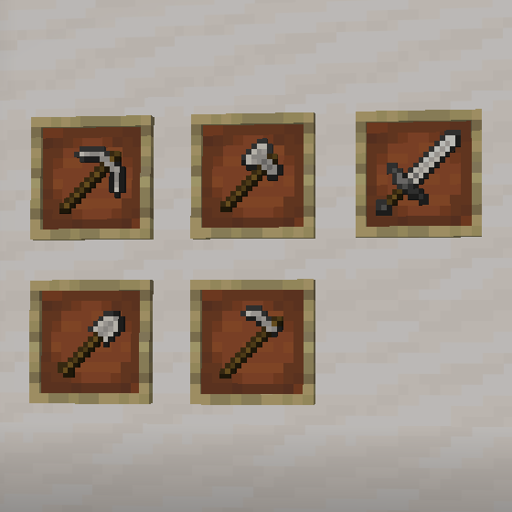

# Quartz Tools

A Fabric mod that adds a full set of tools (pickaxe, axe, shovel, hoe, and sword) crafted from smooth quartz blocks. Quartz tools sit between iron and diamond: cheap and early from the Nether, the easiest tools in the game to enchant well, and fragile enough that they wear out fast.

## Screenshots

## Features

- Pickaxe, axe, shovel, hoe, and sword crafted from smooth quartz blocks and sticks using standard vanilla tool crafting patterns
- Mines anything iron tools can mine (not obsidian or ancient debris: that still takes diamond)
- Mines faster and hits harder than iron, not as fast or as hard as diamond
- Triple the enchantability of diamond, the highest of any tool
- Very low durability: the price of tools this cheap
- Repairable with smooth quartz blocks
- Added to the vanilla Tools and Combat creative tabs
- Takes trims at the smithing table when [Smithing Templates](https://github.com/fatlard1993/smithing-templates) is installed, shown on the tool

### Tool Stats

| Stat | Iron | Quartz | Diamond |
|------|------|--------|---------|
| Mining Level | Iron | Iron | Diamond |
| Durability | 250 | 128 | 1561 |
| Mining Speed | 6.0 | 7.0 | 8.0 |
| Attack Damage Bonus | +2.0 | +2.5 | +3.0 |
| Enchantability | 14 | 30 | 10 |

## Pandorical

Quartz Tools goes on the server only, and **Pandorical is required there and on every player's client**: the tools are new items, and a client without Pandorical has no entry for them.

## Development

Installing is in [DEVELOPMENT.md](DEVELOPMENT.md).

## License

MIT, see [LICENSE](LICENSE).
